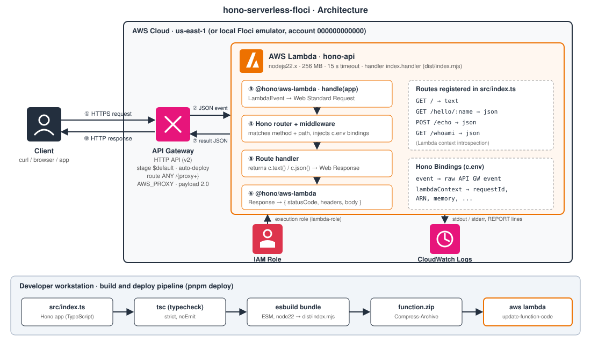
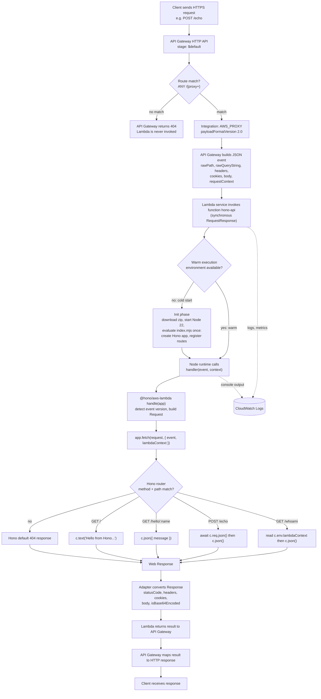
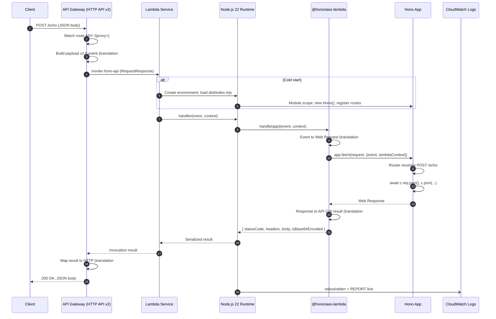
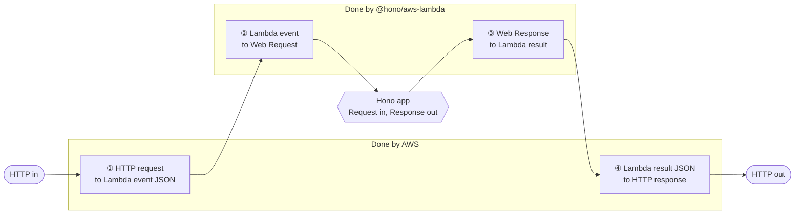
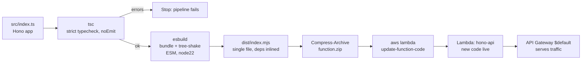

# hono-serverless-floci

> A small, production-minded **Hono** API running on **AWS Lambda** behind an **API Gateway HTTP API**, written in TypeScript, bundled with esbuild, and deployable to real AWS or a local **Floci** AWS emulator with a handful of CLI commands.


**Author:** Collins Olokpedje

---

## Table of contents

1. [What this project is (and is not)](#1-what-this-project-is-and-is-not)
2. [Architecture at a glance](#2-architecture-at-a-glance)
3. [Request lifecycle, in depth](#3-request-lifecycle-in-depth)
4. [The double conversion explained](#4-the-double-conversion-explained)
5. [API reference](#5-api-reference)
6. [Project structure](#6-project-structure)
7. [Getting started](#7-getting-started)
8. [Infrastructure scripts explained](#8-infrastructure-scripts-explained)
9. [Build and deploy pipeline](#9-build-and-deploy-pipeline)
10. [Why Hono?](#10-why-hono)
11. [Who benefits: small business vs. large enterprise](#11-who-benefits-small-business-vs-large-enterprise)
12. [Recruiter and hiring-manager FAQ](#12-recruiter-and-hiring-manager-faq)
13. [Known quirks and roadmap](#13-known-quirks-and-roadmap)

---

## 1. What this project is (and is not)

This repository is a **reference implementation** of a serverless HTTP API. It exists to answer one question: *how does a modern web framework behave when you run it inside AWS Lambda, and what does it cost you in complexity and runtime?*

It contains:

| Piece | Purpose |
|---|---|
| `src/index.ts` | A Hono app with four routes, exported as a Lambda handler via `@hono/aws-lambda` |
| `createFunction.ps1` | Creates the Lambda function (`nodejs22.x`, 256 MB, 15 s timeout) |
| `createApiGateway.ps1` | Creates an HTTP API with a Lambda proxy integration and an auto-deployed `$default` stage |
| `package.json` scripts | Typecheck, bundle, zip and deploy in a single command: `pnpm deploy` |

It is deliberately small. There is no database, auth layer or IaC framework, so every moving part is visible and explainable. The `/whoami` route exposes the live Lambda context so you can observe the runtime (request ID, memory limit, function ARN, version) from the outside.

---

## 2. Architecture at a glance



**Reading the diagram:**

1. A client sends a normal HTTPS request.
2. **API Gateway (HTTP API)** matches the catch-all route `ANY /{proxy+}` and, because the integration type is `AWS_PROXY` with payload format **2.0**, serializes the whole request into a JSON *event*.
3. **Lambda** boots (or reuses) a Node.js 22 execution environment and calls `index.handler(event, context)`.
4. `@hono/aws-lambda` converts that event into a standard Web `Request` and hands it to the Hono app.
5. Hono's router picks a handler; the handler returns a standard Web `Response`.
6. The adapter converts the `Response` back into the JSON result shape API Gateway expects.
7. API Gateway turns that result into a real HTTP response for the client.
8. **IAM** provides the execution role; **CloudWatch Logs** captures everything written to stdout/stderr plus Lambda's `REPORT` lines (duration, billed duration, memory used, init duration).

> **Note on the account ID `000000000000`:** the scripts use the placeholder account and role ARN accepted by local AWS emulators such as Floci. For real AWS, substitute your own account ID and a real IAM role (see [Known quirks](#13-known-quirks-and-roadmap)).

---

## 3. Request lifecycle, in depth

### 3.1 End-to-end flow



### 3.2 Sequence view



---

## 4. The double conversion explained

This is the part most people find confusing, so it gets its own section.

**The core problem:** API Gateway, Lambda and Hono speak three different "languages".

| Layer | Native format | Who owns it |
|---|---|---|
| The internet | Raw HTTP (method, path, headers, body stream) | Client and API Gateway |
| AWS Lambda | A **JSON event object** in, a **JSON result object** out | AWS |
| Hono | **Web Standard** `Request` in, `Response` out (the same `fetch` API as browsers, Deno, Bun, Cloudflare Workers) | Hono |

Neither side knows about the other, so the request is translated twice on the way in and twice on the way out. Two of those four steps are done by AWS and two by the `@hono/aws-lambda` adapter.

### 4.1 The four translations



**① HTTP request → Lambda event (API Gateway).** Because the integration is `AWS_PROXY` with `--payload-format-version 2.0`, API Gateway forwards *everything* in one JSON document. A trimmed example for `POST /echo`:

```jsonc
{
  "version": "2.0",
  "routeKey": "ANY /{proxy+}",
  "rawPath": "/echo",
  "rawQueryString": "",
  "headers": { "content-type": "application/json", "host": "abc123.execute-api.us-east-1.amazonaws.com" },
  "cookies": [],
  "requestContext": {
    "http": { "method": "POST", "path": "/echo", "protocol": "HTTP/1.1", "sourceIp": "203.0.113.7" },
    "stage": "$default",
    "domainName": "abc123.execute-api.us-east-1.amazonaws.com",
    "requestId": "..."
  },
  "body": "{\"message\":\"Hello, World!\"}",
  "isBase64Encoded": false
}
```

The Node.js Lambda runtime then parses this JSON and calls `handler(event, context)`. The second argument, `context`, is separate: it is Lambda runtime metadata (request ID, ARN, memory limit, remaining time), **not** part of the HTTP request.

**② Lambda event → Web `Request` (adapter).** `handle(app)` inspects the event shape (API Gateway v1, v2, ALB or VPC Lattice) and picks the matching processor. For payload v2.0 the mapping is essentially:

| Lambda event field | Becomes on the Web `Request` |
|---|---|
| `requestContext.http.method` | `request.method` |
| `rawPath` + `rawQueryString` + host | `request.url` (a full `URL`) |
| `headers` | `request.headers` |
| `cookies[]` | merged into the `cookie` header |
| `body` (+ `isBase64Encoded`) | `request.body`, base64-decoded when flagged |

The adapter then calls `app.fetch(request, { event, lambdaContext })`. That second argument becomes Hono's **Bindings**, which is why the code can do this:

```ts
type Bindings = {
    event: LambdaEvent;           // the raw API Gateway event
    lambdaContext: LambdaContext; // the Lambda runtime context
};

const app = new Hono<{ Bindings: Bindings }>();

app.get("/whoami", (c) =>
    c.json({ function: c.env.lambdaContext.functionName /* ... */ })
);
```

So your handlers get **both worlds**: portable Web-standard `c.req` for business logic and `c.env.event` / `c.env.lambdaContext` when you need AWS-specific details (authorizer claims, source IP, remaining time).

**③ Web `Response` → Lambda result (adapter).** Your handler returns something like `c.json({...})`, which Hono represents as a standard `Response`. The adapter reads it and builds the shape API Gateway understands:

```jsonc
{
  "statusCode": 200,
  "headers": { "content-type": "application/json" },
  "cookies": [],              // Set-Cookie headers are lifted into this array
  "body": "{\"message\":\"Hello, World!\"}",
  "isBase64Encoded": false    // true for binary content types
}
```

**④ Lambda result → HTTP response (API Gateway).** API Gateway validates this JSON, decodes the body if `isBase64Encoded` is true, and writes a real HTTP response with the status line, headers and body.

### 4.2 Why not just write the raw handler?

You can, and for a single endpoint it is perfectly reasonable. The conversion layer pays for itself as soon as you have more than a couple of routes:

```ts
// Without a framework: you hand-roll all of this
export const handler = async (event) => {
  const method = event.requestContext.http.method;
  const path = event.rawPath;
  if (method === "GET" && path === "/") { /* ... */ }
  else if (method === "GET" && path.startsWith("/hello/")) { /* parse path param by hand */ }
  else if (method === "POST" && path === "/echo") { JSON.parse(event.body ?? "{}") /* base64? errors? */ }
  // headers, CORS, 404s, validation, content types...
};
```

With Hono, routing, params, body parsing, content types, CORS and error handling are solved problems, and the code you write stays **independent of AWS**.

### 4.3 What the conversion costs

The adapter is a thin, synchronous mapping with no network calls. In practice the cost is small compared with Lambda's own cold-start and API Gateway overhead, but it is not zero, so measure it for your workload. Because it is the same Web-standard `Request`/`Response` model everywhere, the same Hono app can move to Cloudflare Workers, Deno, Bun or a plain Node server by swapping the adapter and nothing else.

---

## 5. API reference

| Method | Path | Description | Example response |
|---|---|---|---|
| `GET` | `/` | Plain-text health/hello | `Hello from Hono on AWS Lambda!` |
| `GET` | `/hello/:name` | Greets by path parameter | `{ "message": "Hello John!" }` |
| `POST` | `/echo` | Echoes `message` from the JSON body | `{ "message": "Hello, World!" }` |
| `GET` | `/whoami` | Exposes Lambda runtime context | `{ "function": "hono-api", "requestId": "...", "version": "$LATEST", "memoryLimitInMB": "256", "awsRequestId": "...", "invokedFunctionArn": "arn:aws:lambda:..." }` |

```bash
BASE="https://<api-id>.execute-api.us-east-1.amazonaws.com"   # or your emulator's invoke URL

curl "$BASE/"
curl "$BASE/hello/Ada"
curl -X POST "$BASE/echo" -H "content-type: application/json" -d '{"message":"Hello, World!"}'
curl "$BASE/whoami"
```

---

## 6. Project structure

```text
.
├── src/
│   └── index.ts            # Hono app + Lambda handler export
├── docs/
│   └── architecture.svg    # AWS architecture diagram used above
├── createFunction.ps1      # aws lambda create-function
├── createApiGateway.ps1    # aws apigatewayv2 create-api / integration / route / stage
├── package.json            # scripts: typecheck, build, zip, package, deploy
├── tsconfig.json           # strict TS, noEmit, Bundler module resolution
└── README.md
```

> The build script and `tsconfig.json` (`"include": ["src"]`) both expect the entry point at `src/index.ts`.

---

## 7. Getting started

### Prerequisites

- Node.js **22+** and **pnpm**
- AWS CLI v2
- Windows PowerShell (the `zip` script and infra scripts use PowerShell)
- Either an AWS account **or** a local emulator such as **Floci** (the scripts target account `000000000000`)

### Install

```bash
pnpm install
```

### Scripts

| Script | What it does |
|---|---|
| `pnpm typecheck` | `tsc` in `noEmit` mode: pure type validation under `strict` |
| `pnpm build` | esbuild bundles `src/index.ts` and all dependencies into a single `dist/index.mjs` (ESM, target `node22`) |
| `pnpm zip` | Zips `dist/index.mjs` into `function.zip` (at the archive root so `index.handler` resolves) |
| `pnpm package` | typecheck, then build, then zip |
| `pnpm deploy` | package, then `aws lambda update-function-code` on `hono-api` |

### First-time deployment

```powershell
# 0. (Emulator only) point the CLI at Floci. Check Floci's docs for its endpoint/port.
$env:AWS_ENDPOINT_URL = "http://localhost:4566"
$env:AWS_ACCESS_KEY_ID = "test"; $env:AWS_SECRET_ACCESS_KEY = "test"; $env:AWS_DEFAULT_REGION = "us-east-1"

# 1. Build the artifact
pnpm package

# 2. Create the function (first time only)
./createFunction.ps1

# 3. Create the HTTP API, integration, route and stage (first time only)
./createApiGateway.ps1

# 4. Every change afterwards
pnpm deploy
```

---

## 8. Infrastructure scripts explained

### `createFunction.ps1`

| Flag | Value | Why |
|---|---|---|
| `--function-name` | `hono-api` | Referenced by the API Gateway integration and by `pnpm deploy` |
| `--runtime` | `nodejs22.x` | Matches the esbuild `--target=node22`, so no unnecessary down-leveling |
| `--role` | `arn:aws:iam::000000000000:role/lambda-role` | Execution role; placeholder account for the emulator |
| `--handler` | `index.handler` | File `index.mjs`, export `handler` |
| `--timeout` | `15` | Generous for an API, still well under API Gateway's HTTP API integration limit of 30 s |
| `--memory-size` | `256` | Memory also scales CPU; 256 MB is a sensible starting point for a Node API |
| `--zip-file` | `fileb://function.zip` | Binary read of the zipped bundle |

### `createApiGateway.ps1`

| Step | Command | Result |
|---|---|---|
| 1 | `create-api --protocol-type HTTP --target <lambda-arn>` | Creates the HTTP API (the cheaper, faster, simpler sibling of REST API) and returns `ApiId` |
| 2 | `create-integration --integration-type AWS_PROXY --payload-format-version 2.0` | Tells API Gateway to forward the full request to Lambda using the v2.0 event shape |
| 3 | `create-route --route-key "ANY /{proxy+}"` | One greedy route: **every** method and path goes to the same Lambda; Hono does the real routing |
| 4 | `create-stage --stage-name '$default' --auto-deploy` | A stage with no path prefix; changes deploy automatically |

**Design takeaway:** API Gateway is intentionally "dumb" here (a pass-through), and routing logic lives in code where it can be unit-tested, versioned and moved. This is often called the **"Lambdalith"** or single-function API pattern.

---

## 9. Build and deploy pipeline



**Why this shape?**

- **Typecheck and build are separate steps.** esbuild strips types without checking them, so `tsc --noEmit` is the safety net, and it runs first so bad code never ships.
- **One bundled file, no `node_modules` in the zip.** Smaller package means faster cold-start download and extraction, and no dependency drift between build and runtime.
- **ESM output (`.mjs`).** Native ES modules on Node 22, modern tree-shaking, and top-level `await` available if you ever need to fetch secrets at init.

---

## 10. Why Hono?

**Hono** (Japanese for "flame") is an ultralight web framework built entirely on Web Standard APIs. We chose it for this Lambda API for the following reasons.

### 10.1 The decision in one table

| Requirement for a Lambda API | How Hono answers it |
|---|---|
| Small bundle, fast cold starts | Zero runtime dependencies; the core is tiny and a `hono/tiny` preset exists for extreme cases. esbuild tree-shakes unused middleware |
| Real routing, not `if/else` | Path params, wildcards, grouping, and multiple router implementations optimized for different workloads |
| First-class TypeScript | Generics for `Bindings`, `Variables`, typed `c.req.json<T>()`, and optional end-to-end typed RPC client |
| Avoid vendor lock-in | Built on `Request`/`Response`; the same app runs on Lambda, Cloudflare Workers, Deno, Bun, Vercel and Node |
| Batteries without bloat | Built-in middleware (CORS, JWT, bearer/basic auth, logger, ETag, compress, secure headers, and more) that you only pay for when imported |
| Official AWS support | `@hono/aws-lambda` supports API Gateway v1/v2, ALB and VPC Lattice, with a streaming variant for Function URLs |
| Testability | `app.request("/path")` runs a request through the app **in-process**, so no Lambda or emulator is needed for unit tests |

### 10.2 Pros

- **Lean and fast.** Less code to load at init means less time on the cold-start clock.
- **Portable by design.** Business logic never imports AWS types except at the edge (`c.env`), so migration cost is low.
- **Modern developer experience.** Familiar Express-like ergonomics (`app.get`, `c.json`) with strict types and no `req`/`res` mutation.
- **Great fit for the Lambdalith pattern.** One function, one deployment artifact, one place to look.
- **Ecosystem fit.** Works with Zod, Valibot, OpenAPI generators, and AWS Lambda Powertools for logging and tracing.
- **Actively maintained** with a fast release cadence.

### 10.3 Honest trade-offs

| Trade-off | Mitigation |
|---|---|
| Younger ecosystem than Express; fewer legacy tutorials | Official docs are strong; Web-standard APIs mean general `fetch` knowledge transfers |
| A single Lambda for all routes shares one memory/timeout/permission profile | Split hot or heavy routes into separate functions later; the Hono code moves with you |
| Adapter adds a small conversion step | Negligible relative to API Gateway and cold-start latency; measure before optimizing |
| Response streaming is not available through API Gateway HTTP API | Use a Lambda Function URL with `streamHandle` if streaming is required |

### 10.4 How it compares

| | Hono | Express (+ serverless-http) | Fastify (+ adapter) | NestJS | Raw Lambda handler |
|---|---|---|---|---|---|
| Built for Web Standards | Yes | No (Node `req`/`res`) | No (Node `req`/`res`) | No | N/A |
| Needs a compat wrapper on Lambda | Thin official adapter | Yes (community) | Yes (community) | Yes | No |
| Footprint | Very small | Medium | Medium | Large | Smallest |
| Multi-runtime | Yes | Node only | Node only | Node only | AWS only |
| Built-in routing and middleware | Yes | Yes | Yes | Yes (heavy DI) | No |
| TypeScript ergonomics | Excellent | Add-on typings | Good | Excellent (decorators) | Manual |

Express and Fastify remain excellent choices, especially for teams with large existing codebases. Hono wins here because the goal was *minimal runtime overhead plus portability*.

---

## 11. Who benefits: small business vs. large enterprise

### Small business and startups

- **Near-zero idle cost.** Lambda and HTTP API bill per request and per millisecond; no servers sit idle overnight. (Check current AWS pricing and free-tier terms for your region.)
- **No servers to patch.** AWS manages the OS, runtime security patches, scaling and availability across zones.
- **Ship in a day.** One file, one command (`pnpm deploy`), and a public HTTPS endpoint.
- **Scales without a rewrite.** The same code handles ten requests a day or a traffic spike.
- **Small team friendly.** TypeScript end to end, minimal framework surface area to learn.
- **Avoids lock-in.** If the business later outgrows Lambda or moves clouds, the app is portable.

### Large corporations

- **Standardization.** One Web-standard framework across Lambda, edge (Workers) and containers means shared libraries, shared patterns and shared training.
- **Governance fits naturally.** IAM execution roles, CloudWatch logs, API Gateway authorizers, WAF, throttling and usage plans all sit around the function without code changes.
- **Team autonomy.** Each team can own a small, independently deployable API (microservice-per-function or per-domain Lambdalith).
- **Cost allocation.** Per-function tagging and per-invocation billing make chargeback straightforward.
- **Risk management.** A tiny dependency footprint shrinks the supply-chain and vulnerability-scanning surface compared with large frameworks.
- **Smooth path to scale.** Reserved/provisioned concurrency, SnapStart-style optimizations (where supported), VPC integration and multi-region setups are infrastructure concerns, not rewrites.

---

## important Commands

```powershell
aws apigatewayv2 get-apis --query "Items[].[Name,ApiId,ApiEndpoint]" --output table
```

| Piece | Meaning |
|---|---|
| aws | The AWS command-line tool (pointed at Floci by your environment variables) |
| apigatewayv2 | The service. HTTP APIs belong to apigatewayv2. The older REST APIs use apigateway |
| get-apis | The action: list every API that exists |
| `--query "Items[].[Name,ApiId]"` | A filter on the result, explained below |
| `--output table` | Print the filtered result as a table instead of JSON |

You will most likely see something like `hono-api| 59eff59d7f | https://59eff59d7f.execute-api.us-east-1.amazonaws.com`. That endpoint address is what a real AWS account returns. If you are testing with Floci, the execute address will instead be `http://59eff59d7f.execute-api.localhost.floci.io:4566`.


## 12. Recruiter and hiring-manager FAQ

<details>
<summary><strong>What does this project demonstrate about the author?</strong></summary>

End-to-end ownership of a small cloud service: framework choice with reasoning, TypeScript in strict mode, a reproducible bundle/package/deploy pipeline, hands-on AWS CLI infrastructure (Lambda, API Gateway HTTP API, IAM, CloudWatch), understanding of how requests are translated across service boundaries, and the ability to document and explain all of it.
</details>

<details>
<summary><strong>Why serverless instead of a container or a VM?</strong></summary>

For spiky or low-to-moderate, request-driven workloads, serverless removes capacity planning, patching and idle cost. For sustained high-throughput, long-running or latency-critical-at-every-percentile workloads, containers (ECS/Fargate/EKS) can be cheaper or more predictable. Choosing the right tool per workload is the point, and because Hono is portable, this app could move to a container with only an adapter change.
</details>

<details>
<summary><strong>Why API Gateway HTTP API rather than REST API?</strong></summary>

HTTP APIs are lower cost and lower latency, with simpler setup, and support what this service needs (Lambda proxy integration, `$default` stage, auto-deploy). REST APIs offer extra features such as API keys with usage plans, request validation models and some WAF integrations. If those are required, the same Lambda works with REST API by using the v1 payload, which the adapter also supports.
</details>

<details>
<summary><strong>Why a single catch-all route and one Lambda?</strong></summary>

It keeps infrastructure trivial and routing in testable code. The downside is that all routes share one function's memory, timeout and IAM permissions. At larger scale you can split routes into dedicated functions, a change that is mostly infrastructure because the route handlers remain Hono code.
</details>

<details>
<summary><strong>How do you handle cold starts?</strong></summary>

Design choices already in place: a single esbuild bundle with dependencies inlined, no heavy init work, app and routes created once at module scope (so warm invocations skip it), and a modern Node 22 runtime. Further levers if needed: more memory (more CPU), `hono/tiny`, trimming imports, provisioned concurrency, or SnapStart where supported for the runtime. Measure using the `Init Duration` field in CloudWatch `REPORT` lines.
</details>

<details>
<summary><strong>How would you secure it for production?</strong></summary>

- Replace the placeholder role with a **least-privilege IAM role** (basic Lambda logging only, plus exactly what the app needs).
- Add authentication at the edge: a **JWT authorizer** on API Gateway, or Hono's `jwt()` middleware.
- Add **CORS** (`hono/cors`) restricted to known origins and **secure headers** (`hono/secure-headers`).
- Enable **throttling** on the stage and consider **AWS WAF**.
- Validate input with **Zod** (`@hono/zod-validator`). Note that `/echo` currently trusts the body shape.
- Keep secrets in **SSM Parameter Store / Secrets Manager**, never in the bundle.
- Enforce HTTPS and, for custom domains, ACM certificates.
</details>

<details>
<summary><strong>How would you observe and debug it?</strong></summary>

CloudWatch Logs and `REPORT` metrics out of the box; structured JSON logs via **Lambda Powertools** or `hono/logger`; **X-Ray** or OpenTelemetry for tracing; alarms on `Errors`, `Throttles`, `Duration` p95/p99 and API Gateway `5xx`. The `/whoami` endpoint exposes the request ID so a client-visible response can be correlated with a specific log stream.
</details>

<details>
<summary><strong>How would you test it?</strong></summary>

- **Unit/integration:** Hono's `app.request("/hello/Ada")` runs requests in-process with no AWS dependency. Use Vitest or the Node test runner.
- **Contract/adapter:** invoke `handler` directly with a sample v2.0 event.
- **End-to-end:** run against Floci or LocalStack in CI, then smoke-test the deployed stage with `curl`.
- **Type safety:** `pnpm typecheck` in CI on every pull request.
</details>

<details>
<summary><strong>How would you evolve this into infrastructure as code and CI/CD?</strong></summary>

Replace the PowerShell scripts with **AWS CDK, SAM or Terraform** so the function, role, API, route, integration, permissions and alarms are declared, reviewable and reproducible. Add a GitHub Actions pipeline: install, typecheck, test, build, deploy to staging, smoke test, then promote using Lambda **versions and aliases** (weighted aliases enable canary releases and instant rollback).
</details>

<details>
<summary><strong>What about cost and scaling?</strong></summary>

Costs scale with requests, duration and memory; API Gateway HTTP API bills per million requests. Lambda scales out automatically by adding concurrent execution environments, bounded by account/function concurrency limits you can raise or reserve. Always verify current prices on the AWS pricing pages for your region.
</details>

<details>
<summary><strong>Why esbuild, ESM, Node 22 and TypeScript strict mode?</strong></summary>

esbuild is extremely fast and produces a single tree-shaken file; ESM is the modern standard and aligns with Hono's packaging; Node 22 is a supported Lambda runtime with current language features; strict TypeScript catches whole classes of bugs before deploy.
</details>

<details>
<summary><strong>Is this production-ready?</strong></summary>

It is a production-*minded* reference: the structure, pipeline and patterns are what you would use, but it intentionally omits auth, validation, IaC, tests and alarms. The [roadmap](#13-known-quirks-and-roadmap) lists exactly what would be added.
</details>

<details>
<summary><strong>Could this be deployed on something other than Lambda?</strong></summary>

Yes. Because the app speaks `Request`/`Response`, you swap `handle(app)` for the relevant adapter or `export default app` (Cloudflare Workers/Bun/Deno), or `@hono/node-server` for a container. Only the entry file changes.
</details>

---

## 13. Known quirks and roadmap

### Things worth knowing about the current scripts

1. **`create-api --target` already does a quick-create.** Passing `--target` to `create-api` automatically provisions a default integration, a `$default` route and a `$default` stage. The script then creates an integration, route and stage *again*. On real AWS, creating a second `$default` stage will fail with a conflict. Choose one approach: either keep the quick-create and drop steps 2 to 4, or remove `--target` and keep the explicit steps.
2. **`ANY /{proxy+}` does not match the bare `/` path** on a real HTTP API. Either add a second route `ANY /` or use the `$default` route key as a true catch-all.
3. **Invoke permission.** On real AWS the Lambda needs a resource policy allowing `apigateway.amazonaws.com` to invoke it (`aws lambda add-permission ...`) when the integration is created by hand. Local emulators often skip this check.
4. **Placeholder identities.** `000000000000` and `role/lambda-role` are emulator placeholders; use real values and a least-privilege role on AWS.
5. **Windows-specific zip step.** `pnpm zip` uses PowerShell's `Compress-Archive`. On macOS/Linux, replace it with `zip -j function.zip dist/index.mjs`.
6. **Entry point location.** The build script and `tsconfig.json` expect `src/index.ts`; make sure the file lives there.

### Roadmap

- [ ] Input validation with Zod on `/echo`
- [ ] Unit tests using `app.request()` plus a sample-event handler test
- [ ] Replace PowerShell scripts with CDK/SAM/Terraform
- [ ] CI/CD with GitHub Actions, Lambda versions and aliases
- [ ] Structured logging, X-Ray tracing, CloudWatch alarms
- [ ] JWT authorizer and CORS configuration
- [x] Cold-start benchmark: `hono` vs `hono/tiny` vs raw handler, with results published in this README — see [Cold-start benchmark](#cold-start-benchmark) below

### Cold-start benchmark

Measured against the deployed `hono-api` function (Node 22, 256 MB, single esbuild bundle) via CloudWatch Logs.

**Command**

```bash
aws logs tail /aws/lambda/hono-api --since 30m
```

**Result** — first (cold) invocation:

```
2026-10-26T12:16:11.012000+00:00 2026/10/26/[$LATEST]1cd33ad6 2026-10-26T12:16:11.008Z  b37c833e-abcf-4570-bdad-827166ce0636    INFO    <-- GET /whoami
2026-10-26T12:16:11.012000+00:00 2026/10/26/[$LATEST]1cd33ad6 2026-10-26T12:16:11.010Z  b37c833e-abcf-4570-bdad-827166ce0636    INFO    {"event":"cold-start","durationMs":76}
2026-10-26T12:16:11.016000+00:00 2026/10/26/[$LATEST]1cd33ad6 2026-10-26T12:16:11.014Z  b37c833e-abcf-4570-bdad-827166ce0636    INFO    --> GET /whoami 200 3ms
```

The cold start is **76 ms** (`durationMs` from module load to first request); the handler itself takes **3 ms** once warm.

---

## License

Add the license of your choice (MIT is a common default for portfolio projects).